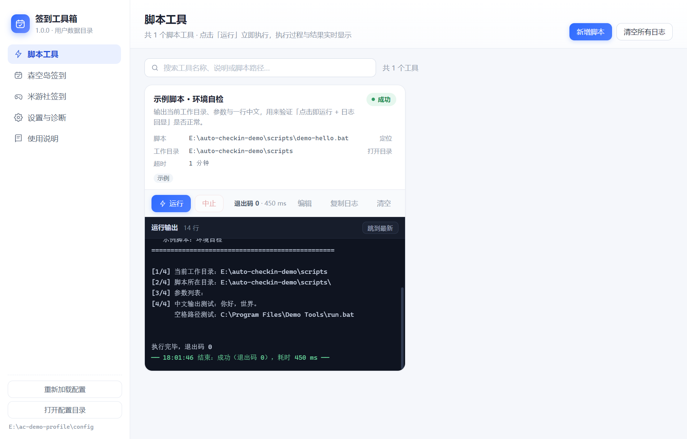
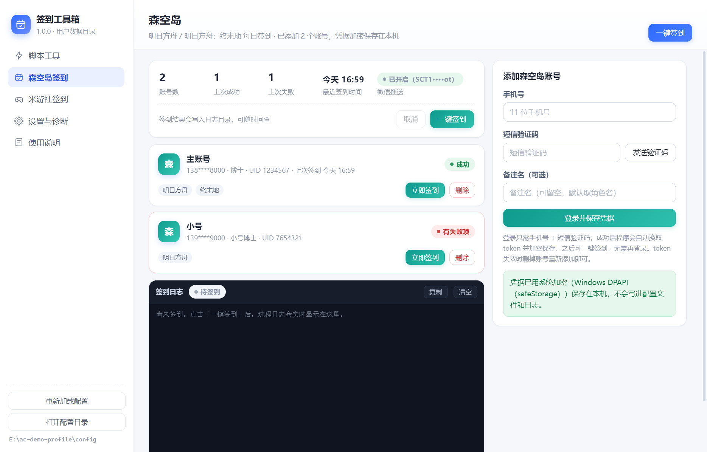
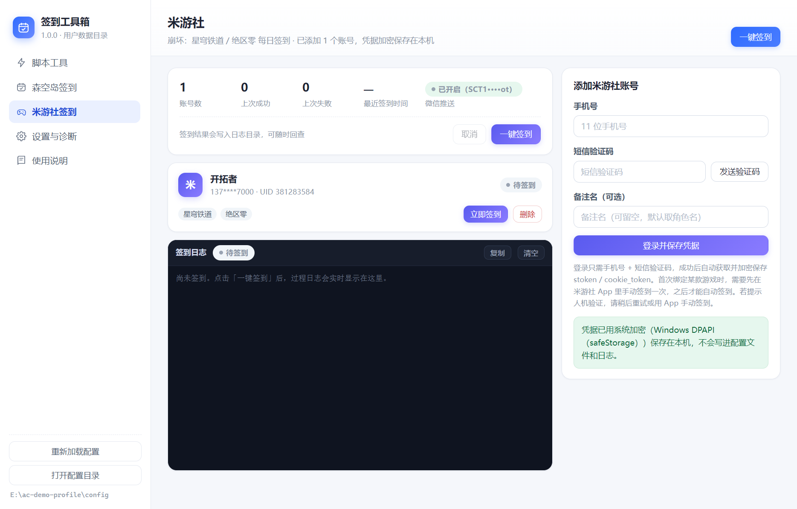
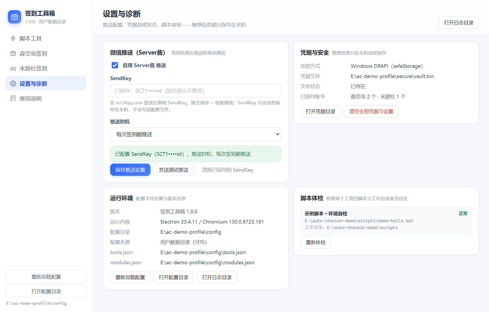

# 签到工具箱（AutoCheckin）

一个面向 Windows 的桌面小工具：把**每日签到**和**跑本机脚本**放进同一个面板。

界面用网页技术（HTML/CSS/JS）编写，外层用 Electron 承载，因此可以打包成单个 `.exe` 直接分发；
功能以「模块（插件）」方式注册，想加一个页面只需要新增一个目录，不用改动主流程。

- **一键运行 `.bat`**：按钮卡片展示，点击即执行，实时显示运行状态、退出码、标准输出与错误
- **森空岛签到**：手机号 + 短信验证码登录，一键签到《明日方舟》《明日方舟：终末地》
- **米游社签到**：手机号 + 短信验证码登录，一键签到《崩坏：星穹铁道》《绝区零》
- **微信推送**：签到结束后通过 Server酱 把结果推到微信
- **凭据本地加密**：账号凭据与推送密钥用系统加密（Windows DPAPI）保存，不写配置文件、不进日志、不回传界面
- **可扩展**：按钮与脚本的对应关系全部在 JSON 配置里，界面内即可增删改









> 截图中的账号、手机号与推送密钥均为演示用的占位数据。

---

## 目录

- [功能说明](#功能说明)
- [安装与运行](#安装与运行)
- [使用指南](#使用指南)
- [配置参考](#配置参考)
- [扩展开发](#扩展开发)
- [安全与隐私设计](#安全与隐私设计)
- [架构说明](#架构说明)
- [错误处理](#错误处理)
- [常见问题](#常见问题)
- [已知限制](#已知限制)
- [许可与声明](#许可与声明)

---

## 功能说明

### 1. 脚本工具

把本机的 `.bat` / `.cmd` 变成面板上的一张卡片，点「运行」立即执行，不需要二次确认。

- 实时显示 **运行中 / 成功 / 失败 / 已超时 / 已中止**，结束时给出退出码与耗时
- 标准输出与错误信息流式回显在卡片里，界面不会因为脚本卡住而失去响应
- 自动设置工作目录（留空则用脚本所在目录），路径含空格、中文、括号都能正常执行
- 脚本超时会强制结束整棵进程树（`taskkill /T /F`），不会留下僵尸进程
- 输出编码自动识别（先按 UTF-8，遇非法字节降级 GBK），老脚本乱码时可强制指定
- 支持搜索、标签、一键清空日志；脚本可在后台并行运行，互不影响

「名称、说明、脚本路径、工作目录、参数、超时」全部写在 `config/tools.json`，也可以在界面里点「新增脚本 / 编辑」直接改。

### 2. 森空岛签到

- 手机号 + 短信验证码登录，登录成功后自动换取并保存签到所需的凭据
- 支持多账号，账号卡片显示备注名、脱敏手机号、角色 UID、上次签到时间与结果
- 一键签到默认跑两个板块：**明日方舟**、**明日方舟：终末地**
- 已经签过的角色会跳过并标注「今天已经签到过了」，不会重复请求
- 凭据失效时只影响该账号，并在日志里提示重新登录

### 3. 米游社签到

- 同样是手机号 + 短信验证码登录，自动获取并保存长短期凭据
- 一键签到覆盖 **崩坏：星穹铁道**、**绝区零**，多角色按顺序处理并带随机间隔
- 短期凭据过期时会自动用长期凭据续期，并把新凭据写回加密存储
- 首次绑定某款游戏时服务端要求先在官方 App 手动签到一次，程序会给出明确提示

### 4. 微信推送

在「设置与诊断」里填入 Server酱 的 SendKey 即可，签到结束后自动推送一条汇总消息：

```
森空岛签到完成：成功 2 · 已签 1
结果：成功 2 · 已签到 1 · 失败 0 · 跳过 0
- ✅ 明日方舟 · 博士（官服）：获得 合成玉×100
- ✅ 明日方舟：终末地 · 管理员（China）：今天已经签到过了
耗时：8.4 秒
```

推送时机可选：每次签到都推送 / 只在有失败项时推送 / 不推送。同一次签到只推一条，避免刷屏。

### 5. 设置与诊断

- 推送配置与测试推送
- 查看凭据加密方式、存储位置与已保存账号数量
- 一键清空全部凭据与设置（二次确认）
- 脚本体检：逐个检查脚本文件与工作目录是否还在
- 打开配置目录 / 日志目录

---

## 安装与运行

### 方式一：下载可执行文件（推荐）

1. 打开 Releases 页面，下载 `AutoCheckin-<版本>-portable.exe`
2. 双击运行，无需安装；首次启动会解压到临时目录，稍等 1~2 秒

如果系统弹出 SmartScreen 提示（未做代码签名时的正常现象），点「更多信息 → 仍要运行」即可。

> 便携版不会写入安装目录，配置保存在用户数据目录（见 [配置参考](#配置参考)）。

### 方式二：从源码运行

前置：**Node.js ≥ 18**（推荐 20 / 22）、Windows 10 / 11。

```bash
npm install     # 首次会下载 Electron 二进制（约 100MB）
npm start       # 启动应用
```

开发期常用命令：

```bash
npm run test       # 核心逻辑自测（不需要 Electron，28 项断言）
npm run smoke      # 离屏冒烟测试：验证界面加载、模块与卡片渲染
npm run icon       # 重新生成应用图标
```

### 打包成 .exe

```bash
npm run dist              # 免安装单文件：dist/AutoCheckin-<版本>-portable.exe
npm run dist:installer    # 安装包（NSIS）：dist/AutoCheckin-<版本>-setup.exe
npm run dist:dir          # 只解包不压缩：dist/win-unpacked/
npm run dist:safe         # 免提权的分步打包（详见下文）
```

首次打包需要下载额外的构建工具，`.npmrc` 已配置镜像，加快下载。

**如果打包报 `Cannot create symbolic link ...`**

构建工具里含有 macOS 的符号链接，普通权限账户在 Windows 上无法创建，于是打包中断。两种解法：

1. 用「管理员身份」打开终端再执行；或开启「设置 → 隐私和安全性 → 开发者选项 → 开发者模式」（一次设置长期有效）
2. 使用 `npm run dist:safe`：跳过 rcedit（不写入 exe 内嵌图标与版本信息，其余功能完全一致）

**关于 SmartScreen**

未做代码签名时，exe 首次运行可能被系统拦一下。要消除提示需要代码签名证书，并在 `package.json` 的
`build.win` 中配置 `certificateFile` / `certificatePassword`。

---

## 使用指南

### 添加签到账号

1. 左侧进入「森空岛签到」或「米游社签到」
2. 右侧填写手机号 → 点「发送验证码」→ 填短信验证码 → 点「登录并保存凭据」
3. 登录成功后程序会自动完成：换取签到凭据 → 读取角色昵称 → **加密保存到本机**
4. 备注名可以留空，默认使用角色名

同一个手机号重复登录会更新已有账号，不会重复添加。

### 一键签到

- 页面右上角或汇总卡上的「一键签到」：对**全部账号**各执行一次
- 账号卡片上的「立即签到」：只跑这一个账号
- 过程中可以随时点「取消」，剩余账号会停止
- 结束后日志给出汇总：成功 / 已签到 / 失败 / 跳过 各多少条

### 新增脚本按钮

界面「脚本工具 → 新增脚本」：

| 填写项 | 说明 |
| --- | --- |
| 名称 | 卡片标题，例如「清理临时文件」 |
| 说明 | 一句话描述，可留空 |
| 脚本路径 | 点「浏览…」选择 `.bat` / `.cmd`，建议用绝对路径 |
| 工作目录 | 留空 = 脚本所在目录；脚本里有相对路径时必须设置正确 |
| 超时 | 秒，默认 300；超时会强制结束整棵进程树 |
| 参数 | 空格分隔，例如 `--check --verbose` |
| 输出编码 | 一般保持「自动识别」 |
| 标签 | 逗号分隔，仅用于展示与搜索 |

保存后会写回 `config/tools.json`（原文件自动备份为 `tools.json.bak`）并立即刷新面板。
也可以直接编辑该文件，然后点左下角「重新加载配置」。

### 配置微信推送

1. 前往 Server酱 官网登录，获取 SendKey
2. 打开「设置与诊断 → 微信推送」，粘贴 SendKey，勾选「启用」
3. 点「发送测试推送」确认能收到消息
4. 选择推送时机后保存

SendKey 只保存在本机加密文件中，界面上只显示脱敏后的值。

---

## 配置参考

### 配置目录在哪

程序不会修改安装目录（可能没有写权限），而是按以下顺序查找配置：

1. 环境变量 `AUTOCHECKIN_CONFIG_DIR` 指向的目录（便于统一分发配置）
2. 免安装 exe **同级目录** 下的 `config`（想让配置跟着 exe 走就放这里）
3. 安装目录下的 `config`
4. 用户数据目录 `%APPDATA%\AutoCheckin\config`（首次运行自动生成，**默认使用**，可读写）
5. 程序内置的只读配置（兜底）

「设置与诊断」页会显示当前实际使用的是哪一个。

### `config/tools.json` —— 按钮与脚本的对应关系

```json
{
  "$schema": "./tools.schema.json",
  "version": 1,
  "tools": [
    {
      "id": "my-tool",
      "name": "我的脚本",
      "description": "这个脚本做什么",
      "script": "D:\\tools\\checkin\\run.bat",
      "cwd": "D:\\tools\\checkin",
      "args": [],
      "timeoutSeconds": 300,
      "encoding": "auto",
      "tags": ["示例"]
    }
  ]
}
```

| 字段 | 必填 | 说明 |
| --- | --- | --- |
| `id` | 是 | 唯一标识（字母 / 数字 / `_` / `.` / `-`），重复的会被忽略并在界面提示 |
| `name` | 是 | 卡片标题 |
| `description` | 否 | 卡片说明 |
| `script` | 是 | `.bat` / `.cmd` 路径。绝对路径最稳妥；相对路径依次按「配置文件所在目录 → 程序目录」解析，支持 `%USERPROFILE%` 这类环境变量 |
| `cwd` | 否 | 工作目录。留空 = 脚本所在目录；不存在会在界面明确报错 |
| `args` | 否 | 字符串数组，例如 `["--check"]`；不支持英文双引号 |
| `timeoutSeconds` | 否 | 超时秒数，默认 300；超时会结束整棵进程树 |
| `encoding` | 否 | `auto`（默认）/ `utf-8` / `gbk` |
| `tags` | 否 | 标签，仅用于展示与搜索 |
| `enabled` | 否 | `false` 时该入口不显示（配置保留） |

仓库自带的配置里有一个开箱即用的示例脚本 `scripts/demo-hello.bat`，另外几条是 `enabled: false` 的写法的示例：
把路径换成自己的，再把 `enabled` 改成 `true` 即可启用。

### `config/modules.json` —— 模块开关与顺序

```json
{
  "order": ["bat-runner", "skland", "miyoushe", "settings", "welcome"],
  "modules": {
    "skland": { "enabled": true, "title": "森空岛签到" },
    "welcome": { "enabled": false }
  }
}
```

- 不在 `order` 里的模块按各自 `module.json` 的 `order` 排在后面
- `enabled: false` 可临时隐藏模块，`title` 可覆盖导航显示名
- `modules.<id>.settings` 会合并进该模块的 `ctx.module.settings`，用于模块级参数

### 目录结构

```
auto-checkin/
├─ package.json                  # 依赖、命令、打包配置
├─ .npmrc                        # 依赖下载镜像
├─ config/                       # 用户可编辑的配置（随程序分发）
│  ├─ tools.json                 #   按钮 ↔ 脚本 映射
│  ├─ tools.schema.json          #   JSON Schema（编辑器自动补全）
│  ├─ modules.json               #   模块开关、顺序、标题
│  └─ modules.schema.json
├─ scripts/
│  └─ demo-hello.bat             # 示例脚本
├─ src/
│  ├─ main/                      # 主进程（Node 环境）
│  │  ├─ main.js                 #   窗口、自定义协议、菜单、IPC、崩溃兜底
│  │  ├─ config-store.js         #   配置读取 / 校验 / 回写
│  │  ├─ runner.js               #   .bat 执行引擎
│  │  ├─ secure-store.js         #   加密存储
│  │  ├─ accounts.js             #   账号与设置仓库（脱敏视图）
│  │  └─ checkin/                #   签到业务（纯 Node，无第三方依赖）
│  │     ├─ http.js              #     请求封装：超时、重试、中文错误
│  │     ├─ skland.js            #     森空岛：登录 / 签名 / 签到
│  │     ├─ miyoushe.js          #     米游社：RSA + DS / 登录 / 签到
│  │     ├─ notify.js            #     微信推送与结果汇总
│  │     └─ index.js             #     调度：发码 / 登录 / 批量签到 / 取消
│  ├─ preload/
│  │  └─ preload.js              # 渲染进程唯一能力入口（白名单）
│  └─ renderer/                  # 前端（无框架，原生 ESM）
│     ├─ index.html
│     ├─ styles.css
│     ├─ app.js                  # 外壳：读模块清单 → 生成导航 → 动态 import
│     ├─ lib/
│     │  └─ checkin-panel.js     # 两个签到模块共用的交互
│     └─ modules/                # 所有功能模块
│        ├─ bat-runner/
│        ├─ skland/
│        ├─ miyoushe/
│        ├─ settings/
│        └─ welcome/
├─ build/icon.ico
├─ tools/
│  ├─ test-core.js               # 核心逻辑自测（28 项）
│  └─ make-icon.py               # 生成图标
└─ dist/                         # 打包产物（构建后生成）
```

---

## 扩展开发

### 新增一个脚本按钮

改配置即可：界面「新增脚本」，或编辑 `config/tools.json` 后点「重新加载配置」。

### 新增一个功能模块

```
src/renderer/modules/my-module/
├─ module.json     # 清单
├─ module.js       # 入口
└─ style.css       # 可选，模块私有样式
```

`module.json`：

```json
{
  "id": "my-module",
  "title": "我的功能",
  "icon": "square",
  "description": "一句话说明",
  "entry": "module.js",
  "styles": ["style.css"],
  "order": 60,
  "defaultEnabled": true
}
```

`module.js`：

```js
export default {
  async mount(root, ctx) {
    const h = document.createElement('h2');
    h.textContent = '你好，这是一个新模块';
    root.replaceChildren(h);

    ctx.setHeader({
      title: '我的功能',
      description: '副标题',
      actions: [{ label: '做点什么', onClick: () => ctx.toast('点了', 'success') }],
    });
  },
  async unmount() {},
  async onConfigChanged(ctx, boot) {},  // 可选：配置变更时原地刷新
  async updateHeader(ctx) {},           // 可选：切到该页时刷新标题
};
```

模块可用的 `ctx`：

| 成员 | 说明 |
| --- | --- |
| `ctx.api` | 主进程白名单能力（`runTool` / `checkin.*` / `saveTools` / `confirm` / `openPath` …） |
| `ctx.boot` | 启动数据：`app`、`config`、`tools`、`rawTools`、`modules`、`checkin`、`warnings` |
| `ctx.module` | 当前模块清单与 `settings` |
| `ctx.setHeader({title, description, actions})` | 控制本页标题与右上角按钮 |
| `ctx.toast(msg, type)` | 轻提示（`info` / `success` / `warn` / `error`） |
| `ctx.el(tag, props, children)` | 创建 DOM 的小工具 |
| `ctx.icon(name)` / `ctx.fmtTime(ms)` / `ctx.fmtWhen(iso)` | 图标与时间格式化 |

模块之间互相隔离：某个模块加载失败只会把该页替换成错误提示，其它模块照常可用。

### 新增一类签到平台

1. 在 `src/main/checkin/` 里仿照现有实现新增一个协议文件
2. 在 `src/main/checkin/index.js` 的 `KIND_META` 里登记平台名与板块
3. 在 `src/renderer/modules/` 下新建目录，入口只需一行：

```js
import { createCheckinModule } from '../../lib/checkin-panel.js';

export default createCheckinModule({
  kind: 'my-platform',
  title: '我的平台',
  subtitle: '每日签到',
  accent: '#0f9b8e',
  avatarText: '签',
  loginTitle: '添加账号',
  loginHint: '登录成功后凭据会自动加密保存。',
  boards: [{ code: 'main', label: '主板块' }],
});
```

登录、账号卡、日志、取消、推送这些交互都由 `lib/checkin-panel.js` 提供，不用重复实现。

### 新增系统能力

在 `src/preload/preload.js` 里加一个白名单方法，并在 `src/main/main.js` 里加对应的 `ipcMain.handle`。
渲染进程始终处于 `sandbox` + `contextIsolation` 状态，拿不到 Node 权限。

---

## 安全与隐私设计

| 数据 | 存放位置 | 保护方式 |
| --- | --- | --- |
| 签到凭据（token / stoken / cookie）、手机号 | 用户数据目录下的加密文件 | Electron `safeStorage`（Windows 上即 DPAPI，与当前系统账户绑定）；先写临时文件再改名，旧文件保留为 `.bak` |
| Server酱 SendKey | 同上 | 同上 |
| 脚本配置（`.bat` 路径等） | `config/tools.json` | 明文（不含任何凭据） |
| 运行日志 | 用户数据目录 `logs/*.jsonl` | 仅记录结果与输出末尾，**不记录凭据** |

具体约束：

- **不留明文**：凭据与 SendKey 不写入任何配置文件；若系统不提供加密能力，程序会拒绝保存，而不是退回明文
- **不回传界面**：主进程在返回数据前就完成脱敏，界面只能拿到 `138****8000`、`abcd••••mn` 这类值，也没有「查看完整凭据」的入口
- **拷走无效**：加密文件与当前系统账户绑定，复制到其他电脑或账户下无法解密；此时程序提示清空凭据后重新登录
- **可一键清除**：「设置与诊断 → 清空全部凭据与设置」
- **无外部上传**：除签到与推送所必需的请求外，程序不会向任何第三方发送数据；没有统计、没有遥测

---

## 架构说明

```
┌──────────────────────────────────────────────────────────────┐
│ 渲染进程（无 Node 权限）                                      │
│   index.html + app.js（外壳）                                 │
│     └─ modules/*/module.js  ← 动态 import，插件化             │
│            │  window.toolbox.xxx()                            │
├────────────┼──────────────────────────────────────────────────┤
│ preload.js │  contextBridge 白名单（sandbox: true）            │
│            │  ipcRenderer.invoke / on                         │
├────────────┼──────────────────────────────────────────────────┤
│ 主进程     ▼                                                  │
│   main.js（IPC 路由、窗口、菜单、日志落盘）                    │
│     ├─ config-store.js（配置读取 / 校验 / 回写）               │
│     ├─ runner.js（spawn cmd → 流式回传 → 退出码）              │
│     ├─ secure-store.js（safeStorage 加解密）                  │
│     ├─ accounts.js（账号仓库 + 脱敏）                          │
│     └─ checkin/（HTTP、森空岛、米游社、推送、调度）            │
└──────────────────────────────────────────────────────────────┘
```

- `nodeIntegration: false` + `contextIsolation: true` + `sandbox: true`
- 页面通过自定义协议 `autocheckin://app/index.html` 加载（而非 `file://`），既能使用原生 ESM 动态 `import()`，也能施加 CSP；协议处理做了目录穿越防护
- CSP：`default-src 'self'`，不允许内联脚本与远程资源（网络请求全部在主进程）
- 单独实例锁：重复启动会聚焦已有窗口
- 退出前结束所有仍在运行的脚本进程树，并中止进行中的签到

---

## 错误处理

| 场景 | 界面表现 |
| --- | --- |
| 脚本路径不存在 | 卡片标为「配置异常」，写明完整路径与「最接近存在的目录」，运行按钮置灰；顶部横幅汇总所有配置问题 |
| 工作目录不存在 / 不是文件夹 | 同上，中文说明 |
| 配置 JSON 写错 | 顶部横幅给出解析错误位置，其它工具照常可用，程序不退出 |
| 同一工具重复点击 | 运行中拦截并提示「正在运行中」 |
| 执行超时 | 自动结束整棵进程树，状态「已超时」，日志给出超时秒数 |
| 脚本返回非零退出码 | 状态「失败」，显示退出码与错误输出 |
| 脚本输出过多 | 单路超过 2MB 自动截断并提示；界面日志超长时自动折叠较早内容 |
| 脚本里有 `pause` | 标准输入接到空设备，立即返回，不会卡住 |
| 验证码发送过于频繁 / 触发人机验证 | 中文提示稍后重试，或建议先在官方 App 手动签到 |
| 凭据过期 | 该账号标记失败并提示重新登录，其它账号继续执行 |
| 微信推送失败 | 日志写明原因，签到结果不受影响 |
| 关闭程序时仍有任务 | 先结束子进程与签到任务，再退出 |
| 界面进程崩溃 | 主进程自动重新加载窗口 |

---

## 常见问题

**Q：中文输出是乱码？**
A：给该工具设置 `"encoding": "gbk"`（老式 ANSI 脚本）或 `"utf-8"`。默认 `auto` 会先按 UTF-8 解码，遇到非法字节自动降级 GBK。
另外 `.bat` 文件本身的编码也很关键：在中文 Windows 上双击能正常显示中文的脚本，通常是 GBK 编码。

**Q：能跑 `.ps1` / `.py` / `.exe` 吗？**
A：目前只支持 `.bat` / `.cmd`。最简单的办法是写一个三行的 `.bat` 包一层：

```bat
@echo off
powershell -NoProfile -ExecutionPolicy Bypass -File "%~dp0xxx.ps1" %*
```

**Q：为什么脚本窗口是隐藏的？**
A：所有输出都回显在卡片日志里，不需要弹出黑窗抢焦点。需要交互的脚本请改成参数驱动。

**Q：换电脑后账号要重新登录吗？**
A：需要。凭据与系统账户绑定加密，换机器或换系统账户都无法解密，重新用手机号登录即可。

**Q：登录时提示需要人机验证？**
A：同一网络下高频发送验证码会触发风控。等几分钟再试，或先在官方 App 里登录 / 签到一次。

**Q：能开机自动签到吗？**
A：签到是交互式设计（需要在界面上点一次）。若要完全无人值守，可以用 Windows 任务计划程序定时运行自己的命令行脚本，把脚本注册成一个按钮方便手动补跑。

**Q：配置文件改不动？**
A：安装到 `C:\Program Files` 时目录是只读的，请使用默认的用户数据目录，或把 `config` 文件夹放到 exe 同级目录。

---

## 已知限制

- 仅支持 Windows（`.bat` / `.cmd`；加密能力依赖 Windows 提供的接口）
- 参数中不能包含英文双引号（配置校验会拦下并提示）
- 不支持需要键盘输入的交互式脚本
- 便携版启动时会解压到临时目录，冷启动比安装版慢 1~2 秒
- 未做代码签名，首次运行可能触发 SmartScreen 提示
- 签到协议跟随官方客户端行为，官方调整后可能需要更新版本；登录或签到失败时都会给出明确的中文原因

---

## 许可与声明

MIT License。

本项目仅用于个人学习与自动化管理自己的账号签到，请遵守各平台的服务条款；使用产生的风险由使用者自行承担。
项目与各游戏 / 社区平台的官方无任何关联。
